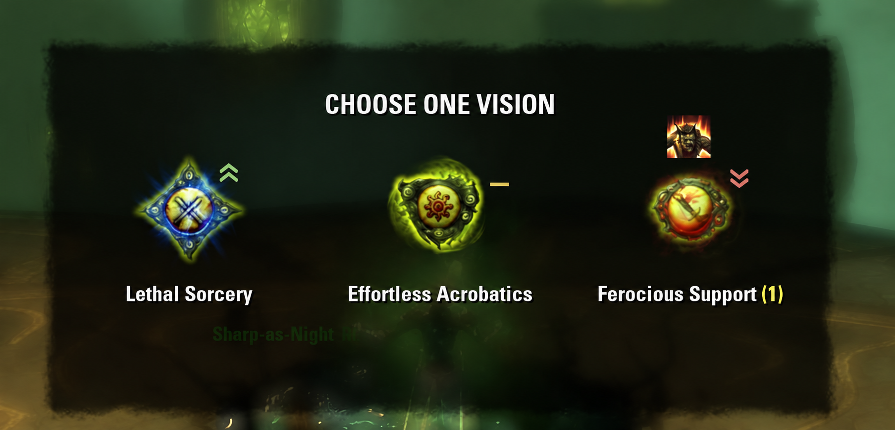

# KanaArchiveAssist: обучение предпочтениям при выборе строф и видений

Дата: 2026-10-15.

План текущей переработки: [обучение на редкой истории](../plans/2026-10-15-kana-archive-assist-sparse-learning.md). Исходный план сохранён как история первой реализации.

Статус: модель v3 переработана по прямому запросу пользователя для 1–2 ранов по две арки в день. Новые правила показа ниже заменяют прежний запрет переноса на неизвестный контекст. Симуляция описана в `KanaArchiveAssist/tests/simulation-report.md`; клиентская приёмка остаётся открытой.

## Цель

KanaArchiveAssist помогает быстрее выбирать строфы и видения в Бесконечном архиве. Аддон учится на реальных выборах пользователя и показывает, какие из текущих вариантов он обычно предпочитает в похожих условиях, включая уже полученные видения и их стаки.

Рекомендация описывает личные предпочтения внутри выбранного профиля. Она не является объективной оценкой эффективности способности или обещанием оптимального прохождения. Решение всегда принимает пользователь. Невозможность уверенно выучить редкие сочетания допустима.

## Согласованные требования

- Отдельный новый аддон с именем `KanaArchiveAssist`.
- Обучение при выборе одной способности из предложения, содержащего два или три варианта.
- Учитываются все предложенные варианты, выбранная способность и контекст до её получения.
- Уже взятые видения и число их стаков могут менять оценку последующих вариантов.
- Семь основных визуальных градаций: от одного до трёх зелёных шевронов вверх, жёлтая горизонтальная линия, от одного до трёх красных шевронов вниз. Линия и штрихи шевронов имеют одинаковую толщину. Метка находится рядом с соответствующим вариантом; предложенная привязка — за правым краем контрола иконки.
- Число шевронов отражает величину выявленного предпочтения. Приведённые пользователем проценты являются примерами, а не фиксированными границами.
- Значок скрывается только у способности, ни разу не встречавшейся в сохранённой истории данного профиля и типа. Если таких данных нет по всему предложению, об этом сообщается в чате.
- Новые соперники, видения и стаки не скрывают известные способности: используются общие предпочтения и доступные поправки, с предварительной силой метки. Неизвестные поправки равны исходному нулю; это допущение модели, а не доказательство отсутствия синергии.
- Если в тройке A и B выбираются примерно одинаково часто, а C почти никогда, у A и B показываются зелёные шевроны, у C — красные. Отсутствие сведений само по себе не означает равенства.
- Если в тройке A явно предпочтительнее B, а B явно предпочтительнее C, средний B получает жёлтую линию.
- Если A явно предпочтительнее двух сопоставимых слабых вариантов B и C, A получает зелёные шевроны, B и C — красные.
- Тултип самого шеврона или жёлтой линии показывает только полезную статистику прошлых выборов. Если подходящих наблюдений нет, тултипа нет; пересказа смысла шевронов и отдельного значка информации нет.
- Интерфейс первой версии предназначен только для клавиатуры и мыши.
- Пользователь управляет профилями. Начальный профиль — `default`.
- Единственная команда аддона — `/kaa`: она открывает окно управления профилями и обучением. Смена, создание и редактирование профилей выполняются в этом окне.
- При входе в Архив аддон сообщает активный профиль и команду `/kaa` для открытия окна уведомлением по центру экрана через тот же игровой API, который использует Reminderz.
- Текущий выбор можно исключить из обучения, сняв флажок `учитывать выбор` в углу экрана. Глобальной паузы и её переключателя в `/kaa` нет.
- Система помогает принять решение и не выбирает способность автоматически.

## Смысл визуальной рекомендации

Оценка относится к текущему предложению и текущему состоянию рана. Одна способность может получить разные метки при разных конкурентах или накопленных видениях.

Жёлтая линия обозначает среднее положение в тройке либо отсутствие выраженного предпочтения во всём текущем наборе. Два равных фаворита получают зелёные метки, если оба заметно лучше третьего. Жёлтая линия у одного среднего варианта не утверждает равенства всех предложенных способностей.

Согласованная таблица поведения при достаточных данных:

| Предпочтения внутри текущего предложения | A | B | C |
| --- | --- | --- | --- |
| A явно лучше B, B явно лучше C | Зелёные | Жёлтая линия | Красные |
| A и B сопоставимы, оба явно лучше C | Зелёные | Зелёные | Красные |
| A явно лучше сопоставимых B и C | Зелёные | Красные | Красные |
| Все три сопоставимы | Жёлтая линия | Жёлтая линия | Жёлтая линия |

Привязка всех значков к медиане не воспроизводит эту таблицу. Представление учитывает роль варианта в конкретном предложении. Для пары сравнение симметрично: выраженное различие даёт зелёную и красную метки одинаковой силы, близость — две жёлтые линии.

Неизвестная способность не считается плохой и не участвует в ранжировании известных. Из двух известных вариантов тройки получается сравнение пары; у третьего метки нет. Если известен лишь один вариант, его метка показывает склонность относительно нулевой общей опоры профиля, с пояснением в тултипе. Это условная оценка общей привычки, не утверждение о победе над неизвестным соперником.

### Предлагаемое преобразование оценок в метки

Пусть `u_i` — оценка варианта внутри модели текущего предложения. Величина различия двух вариантов определяется как `q_ij = tanh((u_i - u_j) / 2)`. Значение лежит между -1 и 1. Для предложения из двух вариантов это эквивалентно `q = 2p - 1`, где `p` — вероятность выбрать данный вариант из пары.

Для тройки сначала определяется один из случаев таблицы выше. В строгой тройке лучший сравнивается со средним, худший — со средним, средний получает жёлтую линию. При двух сопоставимых фаворитах каждый сравнивается со слабым вариантом и получает зелёную метку, а слабый сравнивается с ближайшим из фаворитов и получает красную. При одном фаворите и двух сопоставимых слабых вариантах фаворит сравнивается с сильнейшим соперником, а каждый слабый вариант — с фаворитом.

Предварительные границы, подлежащие проверке:

| Модуль q | Метка |
| --- | --- |
| Меньше 0,15 | Жёлтая линия |
| От 0,15 до 0,35, не включая верхнюю границу | Один шеврон |
| От 0,35 до 0,55, не включая верхнюю границу | Два шеврона |
| От 0,55 | Три шеврона |

При уверенной оценке пары получаются примеры: 55/45 — две жёлтые линии; 60/40 — по одному шеврону; 70/30 — по два; 80/20 — по три. Это прогноз модели, а не необработанная доля исторических кликов.

Для тройки величина характеризует отличие от указанного в правиле соперника внутри этой тройки. Она не является вероятностью выбора в отдельной паре: исключение третьего варианта меняет состав предложения и может изменить прогноз.

Для определения случая тройки оценки сортируются: `u_A >= u_B >= u_C`. Нейтральная граница на шкале оценок — `t = 2 * atanh(0.15)`, примерно 0,302. Обозначения: `d1 = u_A - u_B`, `d2 = u_B - u_C`, `R = d1 + d2`; `L(d)` — число шевронов по таблице границ.

| Условие | Метка A | Метка B | Метка C |
| --- | --- | --- | --- |
| R < t | 0 | 0 | 0 |
| R >= t, d1 < t, d2 >= t | +L(R) | +L(d2) | -L(d2) |
| R >= t, d1 >= t, d2 < t | +L(d1) | -L(d1) | -L(R) |
| d1 >= t, d2 >= t | +L(d1) | 0 | -L(d2) |
| d1 < t, d2 < t, R >= t | +L(R) | 0 | -L(R) |

Последняя строка обрабатывает плавную цепочку: соседние варианты близки, но крайние уже заметно различаются. Равенство соседей не склеивается транзитивно. Ноль означает жёлтую линию, плюс — зелёный, минус — красный. Число шевронов у близких, но не строго одинаковых вариантов может различаться на границе градаций.

Таблица применяется к итоговой смеси вероятностей общей, контекстной и равномерной моделей. Для меток используются логарифмы вероятностей с единой опорой; это сохраняет порядок и отношения вероятностей. При частично известном предложении эксперты нормализуются по известному подмножеству до смешивания. Число шевронов сначала определяется величиной различия, затем ограничивается накопленной историей: один до 8 взвешенных встреч или двух ранов, два до 24 встреч или трёх ранов, максимум три после обоих порогов. Новый стак/видение, отсутствие прямой встречи с известным соперником или один известный вариант ограничивают силу одним шевроном. Ни одно из этих ограничений не скрывает известный перк. Это правила осторожного отображения, не доверительный интервал и не процент правильных решений.

### Тултип метки

Тултип добавляет факты из истории, а не повторяет цвет и число шевронов. Заголовки «Заметный перевес», «Средний вариант» и фразы «Вы скорее выберете A» исключены. Старый интерактивный пример не является эталоном тултипа. Отдельная информационная иконка не нужна.

Тултип показывает для отмеченного перка число выборов из предложений (`2 из 3 · 67%`), разные раны и прямые встречи с нынешними соперниками. В строках прямых встреч счёт `2 : 1` означает выбор этого перка против выбора указанного соперника; выбор третьего варианта не увеличивает ни один счёт. Процент описывает историю предложений с разными конкурентами, не вероятность победы над каждым текущим вариантом и не точность модели.

Отдельно показывается, сколько текущих видений уже встречалось с этим перком в таких или больших стаках; это не число изученных синергий. Точное совпадение набора вариантов и всех видений со стаками даёт дополнительное фактическое число выборов этой ситуации, если такое совпадение было. Без точного совпадения общая статистика сохраняется с явным названием источника. Маленькая история помечается «Предварительная оценка»; неизвестные варианты и сравнение только известной части предложения поясняются словами.

Источник — рабочее окно истории завершённой модели. Если известный перк полностью вышел из окна, он получает жёлтую метку только как носитель явно названной архивной статистики по сохранённым наблюдениям; в сравнении актуальных оценок он не участвует. Неизвестность полностью отсутствующих в истории IDs всё ещё скрывается. Исключённое предложение не добавляет выборов. Тултип содержит реальные наблюдения, не пересказ шевронов. Неизвестный перк без метки не получает пустой тултип.

Тултип принадлежит KanaArchiveAssist, появляется только над существующей меткой со статистикой и закрывается при уходе. Без статистики метка остаётся видимой, но её область не принимает мышь. Без самой метки нет ни области наведения, ни тултипа. Штатное описание способности и тултипы достижений не перезаписываются.

### Визуальный дизайн — предложение для просмотра

Статус: выбранный образец — конкретное изображение с плоскими зелёными и красными шевронами и жёлтой линией на игровом скриншоте, повторно приложенное пользователем. Его точная копия сохранена ниже. Это эталон формы, пропорций, толщины и цветов; интерактивный макет и последующие варианты с рельефом, объёмом или свечением его не заменяют. Новая генеративная перерисовка для восстановления этого оформления не нужна.

Изображение фиксирует выбранное оформление, но не доказывает безопасное расположение для всех игровых текстур. Предложенная ниже привязка за правым краем всего игрового контрола остаётся отдельным вопросом визуальной проверки. Геометрия ниже задана в единицах интерфейса при масштабе 1, а не в физических пикселях монитора.

[Исходный скриншот ArchiveHelper](https://cdn-eso.mmoui.com/preview/pvw12804.jpg). Показанные оценки условны и иллюстрируют интерфейс, а не реальные предпочтения пользователя.

**Образ метки.** Небольшой открытый шеврон с одинаковыми плечами, умеренно скруглёнными концами и отчётливым просветом между повторениями. Зелёный направлен вверх, красный вниз. Одна, две и три фигуры различаются только числом повторений: цвет, толщина и ширина остаются постоянными. Жёлтая оценка — одна горизонтальная черта той же толщины. Направление и число штрихов должны читаться и без различения цветов.

| Свойство | Предложение |
| --- | --- |
| Область наведения | Неподвижный квадрат 32×32 для всех семи состояний |
| Толщина штриха | 3 |
| Шеврон | Ширина по центру штриха 24, подъём 8; видимый габарит около 27×11 с учётом толщины |
| Повторение | Шаг по вертикали 7; габариты двух и трёх шевронов около 27×18 и 27×25 |
| Жёлтая черта | 24×3, по центру той же области |
| Цвета | Спокойный зелёный `#8ECB87`, коралловый красный `#E18A7E`, тёплый жёлтый `#DFC46F` |
| Контраст | Тонкая тёмная тень у контура; без цветного свечения, подложки и рамки вокруг метки |
| Движение | Без пульсации, прыжков и самостоятельной анимации; показ вместе с текущим предложением |

При наведении допустимо небольшое повышение яркости без изменения размеров. Число шевронов обозначает величину предпочтения; при малой или новой истории максимальная сила ограничивается одним шевроном. Не используются дополнительные точки, проценты, буквенные ранги, подписи над каждым вариантом или изменение рамки самой способности. Если данных нет, скрываются и рисунок, и область наведения; пустота не получает тултип.

**Проверенная исходная геометрия.** Нативный keyboard-селектор содержит иконку 140×140 в колонке шириной 220, промежуток между колонками 60; название начинается на 10 ниже иконки. Низ заголовка находится на 30 выше верха иконок. ArchiveHelper уже размещает до трёх значков 48×48 в полосе `y=-36…12` относительно верха иконки. KanaArchiveAchievements размещает свой маленький значок справа от названия и полные карточки ниже окна. Прозрачность верхней части игровых текстур нельзя считать свободным местом: там возможны орнамент, подсветка и частицы аватара.

**Геометрия: справа за границей всего контрола иконки.** Привязка к видимому силуэту предыдущего эскиза исключена как ненадёжная. Нативный `Icon` одинаков для всех способностей — 140×140; меняется текстура и заполнение её прозрачных полей. Стартовый якорь метки: её `LEFT` к `Icon.RIGHT` с зазором 6 и выравниванием центров по Y. Для штатной колонки это область `x=186…218, y=54…86`. Основной рисунок находится в `x=40…180, y=0…140`: области не пересекаются независимо от формы нарисованного перка. Ряд ArchiveHelper заканчивается на `y=12`, а имя начинается на `y=150`. Заголовок и остальные элементы не сдвигаются.

Размер и край берутся у фактического игрового контрола с учётом его масштаба, а не из ID способности или координат картинки. Поэтому изменение размеров контрола должно переставлять метку за его новый край. Для пары используются две фактические способности без пустой третьей колонки. Место метки не прыгает при изменении числа шевронов или появлении сторонних значков.

**Свечение — отдельное ограничение.** Нативный `Highlight` имеет масштаб 1,75, а частицы аватара могут расширяться до 1,5. Их номинальные прямоугольники больше основного рисунка: соответственно `x=-12,5…232,5, y=-52,5…192,5` и `x=5…215, y=-35…175`. Предлагаемая область находится внутри этих эффектов. Это не гарантированно пустая зона; шейдер также не позволяет считать геометрию контрола доказанными границами видимых пикселей.

Метка рисуется поверх декоративного свечения своим слоем; игра сохраняет все свои эффекты. Тонкая тёмная тень у контура должна отделять плоский знак от светлого фона, но одной этой меры недостаточно, чтобы объявить контраст проверенным. В клиенте нужны наиболее яркое наведение и аватар с максимальным свечением. Если метка сливается, этот вариант оформления не проходит приёмку. Отнесение её за всё свечение значительно увеличит зазор, а непрозрачная подложка изменит вид — ни один из этих компромиссов не вводится незаметно.

Область наведения 32×32 также находится за основным рисунком и не перекрывает чужие интерактивные элементы. При изменённой сторонним аддоном геометрии дополнительно проверяются соседняя колонка, названия и значки. Если свободного места больше нет, нельзя рисовать поверх чужого элемента: такая компоновка требует отдельного решения и не считается поддержанной по одному скриншоту.

**Состав тултипа.** Одна компактная тёмная панель в стиле штатного ESO-тултипа, до380 единиц ширины, поля18. Без вложенных карточек, кнопок, логотипа, копии шеврона или повторного описания способности. Заголовок — название перка (`ZoFontWinH3`); при ограниченной истории спокойная подпись «Предварительная оценка». Далее две выровненные строки: «Выбран — 2 из3 ·67%» и «Разные забеги —2». Это общая фактическая история перка в рабочем окне.

Раздел «Прямые встречи» показывает названия нынешних соперников и счёт выборов справа. Формат «этот перк : соперник» поясняется одной строкой; выбор третьего не учитывается. Ниже при необходимости — экспозиция текущих видений/стаков, число точных совпадений ситуации и профиль. Названия переносятся, числа выровнены; при смене секций pooled controls сбрасывают выравнивание и размеры. Текст `ZoFontGame`, пояснения `ZoFontGameSmall`, без цветовой кодировки ранга и новых рамок. Объём фактов зависит от истории; пустые разделы не создаются.

Нет коэффициентов, искусственных процентов уверенности или обещания эффективности в бою. Исключение текущего выбора управляется отдельным флажком на экране выбора.

**Появление и размещение тултипа.** Показ после короткого удержания мыши над областью метки, ориентир 150 мс; закрытие при выходе. Тултип не следует за курсором. Основная позиция — над окном выбора, на 12 выше его верхней границы, с центром по X над меткой и ограничением по краям экрана. Он не должен закрывать заголовок, метки оценок или другие способности. Если сверху не хватает места, используется свободное боковое место; если оно занято штатным тултипом, предпочтительно временно перекрыть декоративный фон или часть карточек достижений, сохранив варианты выбора и их метки. При недостатке места текст переносится, а не уменьшается до мелкого шрифта. После выхода всё перекрытое снова видно без изменения состояния.

Область метки принимает наведение только при наличии статистики, но не выбор способности, двойной щелчок или подтверждение. Визуальная текстура внутри неё сама не принимает мышь. Область исключена из расчёта размеров штатного окна. Штатные обработчики наведения на способности не заменяются; поведение при переходе между иконкой, меткой и достижениями проверяется в клиенте. Тултип использует собственный контрол; общий `InformationTooltip` и другие панели не очищаются.

**Критерии визуальной приёмки.** На настоящих скриншотах в масштабе 1:1 оценить близость метки к своему перку, читаемость плоских штрихов и соответствие выбранному первоначальному эскизу. Метка должна оставаться менее заметной, чем способность; объём, фаски и собственное цветное свечение не добавляются. Проверить все семь меток в обычном и уменьшенном масштабе: три шеврона различимы, жёлтая линия не теряется, наведение удобно. Отдельно посмотреть рисунок, заполняющий весь квадрат 140×140, и рисунок с большими прозрачными полями; пару и тройку; все роли оценок и отсутствие данных; длинные русские названия и профиль; все три значка ArchiveHelper; максимально яркое штатное наведение и свечение аватара; нижние карточки достижений; положение у границ экрана. Сравнить исходные координаты нативных элементов до и после подключения. Наложение на скриншот проверяет композицию; наведение, масштабирование и динамические эффекты подтверждаются только в клиенте ESO.

## Профили

Каждый профиль содержит собственную историю выбора и обученную модель. Выборы из другого профиля не должны незаметно менять его рекомендации. Переключение профиля выбирает другую историю; переименование сохраняет накопленное обучение.

Единственная команда `/kaa` открывает окно `KanaArchiveAssist`. Окно доступно внутри и вне Архива. Повторный вызов выводит уже открытое окно на передний план; открытие окна само по себе не меняет профиль или состояние обучения. Подкоманд нет.

В окне видны текущий активный профиль и его история. Пользователь согласовал [макет на игровом скриншоте](assets/kana-archive-assist-profile-window-approved.png): компактная полупрозрачная панель со штатными шрифтами и разделителями ESO, выпадающим списком, сводкой и последней записью. Управление профилями устроено так:

| Элемент окна | Результат |
| --- | --- |
| Штатный прокручиваемый выпадающий список | Выбор профиля для просмотра и редактирования; активный профиль отмечен отдельно |
| `Использовать профиль` | Переключение на просматриваемый неактивный профиль; выбор пункта списка сам не переключает обучение |
| `+ Новый` | Отдельная форма имени, создание пустого профиля и переключение на него после подтверждения |
| `Переименовать` | Отдельная форма имени просматриваемого профиля с сохранением истории; сохранение кнопкой или Enter, отмена без изменений |

Сводка показывает всю валидную уникальную историю профиля: общее число учтённых выборов, число в текущем незавершённом ране этого персонажа, строфы и видения отдельно, число разных ранов с данными. Счётчики не ограничены рабочим окном модели и не включают исключённые или неподтверждённые выборы. Индекс сводки строится при загрузке истории и обновляется при добавлении записи; перечитывания всей истории каждый кадр нет.

Последний учтённый выбор показывает локализованное название способности, последовательный номер записи, доступные арку/цикл/этап и точные дату/время учёта для новых записей (`recordedAt`, `recordedDate`, `recordedTime`). Старый `timestamp` обозначает появление предложения и не выдаётся за время учёта. Для ранних записей окно прямо сообщает, что время учёта не фиксировалось.

Нижняя строка показывает ожидание предложения, предложение получено, исключение текущего выбора, ожидание ответа игры, успешный учёт, завершённое исключение или сбой с понятной причиной. История увеличивается только после сопоставленного игрового результата. Ожидание более 30 секунд завершается ошибкой без записи; отсутствие предложения, неверный выбранный вариант, несовпадение результата и отказ истории также видны. Последний завершённый результат хранится в профиле и переживает `/reloadui`; при новом предложении предыдущий сбой остаётся предупреждением до следующего завершённого результата. Окно подтверждает изменение истории в памяти; сохранение на диск управляется клиентом ESO.

Имена вводятся в текстовом поле и могут содержать пробелы. У профиля есть постоянный внутренний идентификатор, независимый от имени. Конфликт имён, пустое имя или попытка использовать несуществующий профиль не изменяют данные; ошибка показывается рядом с соответствующим полем или действием в окне. Управляющие последовательности разметки ESO в именах не разрешаются. Отмена создания или редактирования не сохраняет изменения.

Окно управляется мышью и клавиатурой, закрывается кнопкой закрытия или Escape. Длинный список профилей и содержимое окна прокручиваются; последний профиль и все действия остаются доступны при уменьшенном разрешении или изменённом масштабе интерфейса. На узкой панели действия формы располагаются в два ряда, текст переносится; выпадающее меню ограничено шириной окна. Обновление истории и повторный `/kaa` не стирают черновик имени и не перестраивают открытый список.

Пример уведомления при входе: заголовок `KanaArchiveAssist: профиль «default»`, подстрока `Обучение включено · Управление: /kaa`. Уведомление выводится по центру экрана, без дублирования выбранного режима в чат.

Профили доступны всем персонажам аккаунта на одном сервере, а активный профиль запоминается отдельно для каждого персонажа. Первое включение создаёт `default`; новый персонаж начинает с него, пока пользователь не выберет другой профиль. Если стартовый профиль был переименован, используется его прежний внутренний идентификатор, а не создаётся новая пустая история. Автоматического определения билда или переключения профилей нет.

Если профиль меняется при открытом предложении, рекомендации пересчитываются. Наблюдение должно однозначно принадлежать профилю, действовавшему при подтверждении выбора; позднее переключение не переносит его в другую историю.

## Исключение одного выбора

На keyboard-экране выбора квадратный флажок слева от постоянной подписи `учитывать выбор` располагается в правом нижнем углу **экрана, вне нативного окна с перками**. Родитель — отдельное прозрачное top-level окно без перехвата мыши, цель привязки строки — `GuiRoot`, BOTTOMRIGHT к BOTTOMRIGHT, x=-32; нижний отступ не меньше64 и увеличивается до верхней границы видимой `ZO_KeybindStripControl` с зазором16. Прямой родитель `GuiRoot` не обеспечивает отрисовку обычного контрола; исправление с оконным контейнером подтверждено игровым экспериментом. Высота строки32, флажок20×20, зазор до подписи8, ширина строки по тексту с ограничением по экрану; размеры и положение селектора на строку не влияют. Используются штатные `ZO_CheckButton` и `ZO_CheckButtonLabel` с `ZoFontGame`; квадрат и подпись кликабельны, отдельный tooltip не добавляется. Окно выбора, перки, переброс, валюта и панель достижений не перемещаются. При изменении размеров экрана и полосы действий положение пересчитывается. Флажок и его контейнер показываются только для текущего предложения и скрываются при его закрытии или подтверждении. Профильное окно сохраняет прокрутку, все действия, навигацию и малый размер; удаляется только переключатель паузы.

По умолчанию галочка установлена: выбор учитывается. Снятие галочки исключает текущее предложение; повторная установка возвращает учёт до подтверждения. Подпись никогда не меняется. Флажок не подтверждает способность и не вызывает игровой выбор. Метки остаются видимыми, даже если текущий выбор исключён или модель ещё не обучена.

Флаг принадлежит offerId, сохраняется при обновлении и повторном открытии того же предложения и при смене профиля. Он сбрасывается на новом предложении, перебросе, завершении/новом ране и инвалидировании предложения. В момент подтверждения фиксируется вместе с профилем; запоздавшая обработка после закрытия окна не возвращает исключённый выбор в обучение. Старые сохранённые глобальные флаги паузы больше не действуют.

Исключённое подтверждённое предложение не записывается в историю и не даёт счётчиков побед/поражений или встреч. Полученный бафф продолжает существовать в игре; следующее предложение получает свежий список видений и стаков. Следующий обычный выбор записывается автоматически. Это замена паузы, а не удаление старых записей после завершения выбора.

## Пользовательский сценарий

1. При входе в Архив пользователь видит по центру экрана активный профиль, состояние обучения и команду `/kaa`, открывающую окно управления.
2. При появлении предложения аддон получает все варианты и копию контекста рана.
3. На основании истории выбранного профиля вычисляются рекомендации и достаточность данных.
4. Рядом с вариантами появляются обоснованные метки. Если часть необходимых оценок недоступна, в чате появляется краткое пояснение.
5. Наведение, смена фокуса и чтение описания не считаются голосами.
6. Подтверждённый и сопоставленный с результатом выбор добавляет одно наблюдение. Обновлённая модель используется для следующих предложений.
7. Переброс обновляет предложение и метки; сам по себе не становится отрицательным голосом против всех прежних вариантов.

Сообщение о нехватке данных выводится один раз на актуальное предложение и перечисляет варианты, для которых метка не показана. Если неизвестен весь набор, достаточно одной общей фразы. Наведение, перерисовка и повторное открытие неизменившегося предложения не повторяют сообщение; переброс или смена профиля создают новый контекст уведомления. Сообщение об отсутствии истории появляется один раз на предложение и профиль. При частичной истории известные метки показываются без предупреждения на каждый неизвестный вариант.

## Данные для обучения

Единица истории — целое предложение с одним выбранным победителем. Нужны стабильные идентификаторы способностей, их тип, полный состав предложения, выбранный вариант, копия видений со стаками до выбора, профиль, идентификатор рана, время и версия формата данных. Арка, цикл и этап сохраняются как доступные признаки контекста; их включение в модель требует отдельного обоснования.

Выбор A из A/B/C не определяет порядок B и C. Его нельзя записывать как полный рейтинг A > B > C или как ничью B = C. Две пары с одним победителем также нельзя считать двумя независимыми наблюдениями при оценке уверенности.

Исходная история хранится отдельно от вычисленного состояния модели. Это позволяет проверить обучение и пересчитать модель после изменения алгоритма. Простая таблица счётчиков пар не является единственным источником истины. Полная история сохраняется без автоматического удаления; обучение использует ограниченное рабочее окно. Видения в каждой записи хранятся компактным массивом идентификаторов и стаков, без копий описаний и названий.

Случайная выдача строф, восстановление списка баффов при загрузке и повторное событие о том же выборе не создают новые голоса. Один реальный выбор даёт не более одного наблюдения.

## Математическая модель v3

Общий и контекстный регуляризованные эксперты сохраняют семантику целого предложения. Для контекстного эксперта и i из S:

`u_i = a_i + sum_v dot(b_i,v, f(stacks_v)) + sum_(j in S, j != i) c_i,j`

`P(i | S, visions) = exp(u_i) / sum_(j in S) exp(u_j)`

`a_i` переносит общую привычку между любыми соперниками. `b_i,v` — поправки при накопленных видениях. `c_i,j` — направленные поправки внутри предложения; они позволяют учить циклы, не навязывая глобальный транзитивный порядок. Пороговые признаки стаков: `I(n>=1), I(n>=2), I(n>=3), log(1+max(n-3,0))`.

От нескольких видений поправки складываются. Произвольные взаимодействия трёх и более видений не моделируются. Нетранзитивность среди всех редких пар не выучится быстро: без повторений модель преимущественно опирается на a. Это приемлемое ограничение, не обещание знать все сочетания.

Минимизируется сумма взвешенных отрицательных логарифмов вероятностей реальных выборов плюс `0.5 * sum(lambda_k * theta_k^2)`. Штрафы v3: `a=2`, `b=16`, `c=2`. Сильное стягивание контекстных коэффициентов удерживает редкие совпадения от немедленного превращения в сильную синергию. Невиденные координаты имеют исходный ноль, а сама способность без истории остаётся без значка.

Общий эксперт использует только a. Контекстный — все коэффициенты. Третий эксперт считает варианты равными. При четырёх и более обучающих ранах последняя четверть (с округлением вверх) целых runId исключается из обоих проверочных fit; все обучающие записи после начала контрольного участка также исключаются, включая возобновлённые старые раны. На оставшихся более поздних выборах накапливается взвешенный NLL каждого эксперта.

Веса смеси пропорциональны `prior * exp(-validationNLL)`, priors uniform/base/context =0.4/0.4/0.2. После нормировки каждый вес становится `0.02 + 0.94 * weight`, сумма остаётся1. Это экспоненциальный выбор предсказывающего эксперта, а не байесовская уверенность в ранге. Затем общий и контекстный эксперты переобучаются на всей прошлой истории. До четырёх ранов используется общий эксперт. Прогноз следующего выбора ни на одном шаге не участвует в собственной калибровке.

Итог `P = w_uniform / |S| + w_base * P_base + w_context * P_context`. Для ≥2 известных вариантов метки используют смесь распределений, предварительно нормализованных только по известным; полные вероятности предложения сохраняются отдельно для NLL. Для одного известного варианта используется виртуальный соперник с исходной оценкой0 и log-odds смеси. Неизвестный третий вариант не должен менять сравнение известных.

Строфы и видения имеют отдельные модели в каждом профиле. Один выбор из трёх остаётся одним наблюдением; проигравшие между собой не сравниваются. История хранится полностью. Для fit берутся последние 2000 наблюдений каждого типа, вес `2^(-age/30)`, где age — последующие раны с обучением этого профиля и типа. Это 15–30 дней при 1–2 ранах в день. Давность не является сроком удаления записи. Календарное время, исключённые выборы и другие профили не старят модель.

L-BFGS с памятью 8, Armijo, тёплым стартом, допуском 1e-6 и максимумом 500 итераций публикует только сошедшиеся эксперты. Расчёт порционный, целевой бюджет 2 мс. При технической ошибке прогноз не выдумывается; причина выводится в чат. Старые saved variables версии истории 1 пересчитываются без удаления и смены схемы.

Удалены bootstrap-ансамбль, порог 15/16, обязательные шесть встреч в трёх ранах, проверки связности/линейной поддержки/рычага/доли регуляризации. Эти запреты делали аддон почти бесполезным на редкой контекстной истории. Порог достаточности теперь влияет на максимальную силу, а не на сам факт показа. Жёлтая линия — близость центральных оценок или середина; она не является доказанной статистической эквивалентностью.

## Интеграция с ESO и сохранение интерфейса

Доступные точки интеграции:

- `GetEndlessDungeonBuffSelectorBucketTypeChoice(bucketType)` для идентификаторов вариантов.
- Отдельные потоки подсветки `SelectBuff` и подтверждения `CommitChoice`.
- `ENDLESS_DUNGEON_MANAGER:GetAbilityStackCountTable(ENDLESS_DUNGEON_BUFF_TYPE_VISION)` для текущих видений и стаков; перед выбором сохраняется копия изменяемой таблицы.
- Обновление предложений и состояние переброса, позволяющие убрать старые метки.

`CommitChoice` означает отправку выбора и не доказывает само по себе серверное применение. Надёжное наблюдение требует сопоставления снимка предложения, подтверждения и последующего результата. При неоднозначности предпочтительнее пропустить обучение, чем записать неверный голос.

Сохраняются существующие свойства окна: все варианты, штатные описания, расположение заголовка и остальных элементов, размеры панели, выбор мышью, подтверждение, переброс, валюта и работа при меньшем разрешении или изменённом масштабе. Метки принимают наведение только при наличии статистики для тултипа, но не выполняют выбор и не заменяют обработчики способности. При закрытии и перебросе старые метки скрываются. В режиме геймпада интерфейс и обучение KanaArchiveAssist не подключаются; штатный селектор продолжает работать.

Нужна совместимость с ArchiveHelper и KanaArchiveAchievements: новые шевроны не перекрывают значки целей и не нарушают область полных тултипов с её прокруткой. Чужие аддоны не копируются и не редактируются. Для идентификаторов, названий и состояния достаточно штатного API, поэтому обязательных зависимостей от других аддонов в первой версии нет.

Уведомление о профиле и режиме использует штатный `CENTER_SCREEN_ANNOUNCE:CreateMessageParams` и `CENTER_SCREEN_ANNOUNCE:AddMessageWithParams`. Установленный Reminderz вызывает их через `CSAnnounce.System` в `utils.lua` и `TBO_Reminder:Remind` в `TBO_Periodic.lua`. KanaArchiveAssist использует игровой диспетчер самостоятельно; зависимость от Reminderz не нужна. Сообщения о недостатке данных остаются в чате; управление профилями и пояснения к нему находятся в окне `/kaa`.

Уведомление показывается один раз при переходе извне в Архив или загрузке интерфейса уже в Архиве, а также после смены активного профиля или режима обучения в окне. Переходы между аренами одного рана не повторяют его. Стартовая длительность — пять секунд; категории `CSA_CATEGORY_LARGE_TEXT` и `CENTER_SCREEN_ANNOUNCE_TYPE_SYSTEM_BROADCAST`, без звукового сигнала.

Идентификатор рана хранится между перезагрузками интерфейса. Новое подтверждённое начало рана создаёт новую группу; восстановление менеджером активного состояния не считается новым раном. Это существенно: нативный `OnDungeonInitialized` может вызывать `OnDungeonStarted` при восстановлении уже начатого рана. Если непрерывность нельзя установить однозначно, статистика независимых ранов не увеличивается на основании одного переподключения. Адаптер должен пройти отдельный клиентский эксперимент на этих событиях.

## Разделение компонентов

- `Profiles` и `History`: профили, исходные наблюдения, окно, индексы фактической статистики.
- `RunCapture` и `ESOAdapter`: игровой жизненный цикл и подтверждение ровно одного выбора.
- `Features` и `ChoiceModel`: разреженные признаки, fit двух экспертов, последовательная калибровка и смесь прогнозов.
- `ContextSupport`: свидетельства для каждого текущего перка и ограничение силы без блокировки нового контекста.
- `Grades`: роли известной части предложения и семи градаций.
- `View`, `ProfileWindow`, `Controller`: существующий интерфейс, статистика и порционный пересчёт.

## Проверка качества

Сначала выполнен исследовательский прогон до изменения продуктовой модели. Контрольный seed 17 использован для выбора параметров. Основная симуляция вызывает фактическую Lua-модель и использует отдельные seeds 73, 271, 2027, 8191. Полный тестовый каталог — 111 способностей из установленного ArchiveHelper: 54 строфы и 57 видений; аватарные строфы доступны после трёх частей. В ране 10 циклов по две строфы и одному видению, контекст накапливается из настоящих выборов симулированного пользователя. Наборы 2/3 и частоты выдачи — явно описанные допущения, серверные веса неизвестны.

Наблюдения добавляются после прогноза. Первые два рана fit обновляется после каждого выбора, далее между ранами; нет разогрева и исключения трудных переходных участков. Отдельные сценарии проверяют общую привычку, контекст, стаки, циклы, полное равенство, смену привычки и редкие предложения. Результаты по дням и сравнение с общим рейтингом сохраняются в `KanaArchiveAssist/tests/simulation-report.md`. Высокое покрытие само по себе не считается точностью. Симуляция не предсказывает персональную точность на реальных ранах и не доказывает клиентское поведение ESO.

## Источники

- [Seshadri et al., Discovering Context Effects from Raw Choice Data, 2019](https://proceedings.mlr.press/v97/seshadri19a.html): вероятностный выбор из набора, взаимодействия вариантов, компактная параметризация и ограничения идентификации.
- [Chen and Joachims, Modeling Intransitivity in Matchup and Comparison Data, 2016](https://www.cs.cornell.edu/~shuochen/pubs/wsdm16_chen.pdf): моделирование нетранзитивных предпочтений.
- [Microsoft Research, TrueSkill](https://www.microsoft.com/en-us/research/project/trueskill-ranking-system/): отделение оценки от неопределённости; обычный рейтинг не является готовой моделью синергий для этого аддона.
- [Штатный селектор ESO](https://github.com/esoui/esoui/blob/live/esoui/ingame/endlessdungeon/endlessdungeonbuffselector_shared.lua): подтверждение, предложение и жизненный цикл.
- [Шаблон селектора ESO](https://github.com/esoui/esoui/blob/live/esoui/ingame/endlessdungeon/endlessdungeonbuffselector_shared.xml) и [шаблон способности](https://github.com/esoui/esoui/blob/live/esoui/ingame/endlessdungeon/endlessdungeonbuff_shared.xml): размеры, якоря, подсветка и доступное место для меток.
- Установленные `../ArchiveHelper/ui/buffSelector.lua`, `../ArchiveHelper/ui/icons.lua`, `KanaArchiveAchievements/View.lua`: фактически занятые области над иконками, возле названий и ниже селектора.
- `KanaArchiveAchievements/Controller.lua` и его спецификация: существующие точки подключения, обновление после переброса и сохранение соседних элементов интерфейса.
- Установленный `../Reminderz/utils.lua`, `CSAnnounce.Make` и `CSAnnounce.System`; `../Reminderz/TBO_Periodic.lua`, `TBO_Reminder:Remind`: штатный механизм уведомлений по центру экрана, используемый напоминаниями о еде.

## Согласование

- 2026-10-15: пользователь разрешил проектирование нового KanaArchiveAssist и последовательные вопросы о результате.
- 2026-10-15: приняты отсутствие метки при нехватке данных и пояснение в чате; неполное изучение сочетаний допустимо.
- 2026-10-15: приняты профили, начальный `default` и сообщение при входе; итоговое решение по управлению — единственная команда `/kaa`, открывающая окно создания, редактирования и переключения профилей с переключателем обучения.
- 2026-10-15: итоговое решение для двух равных фаворитов — две зелёные метки и красная у слабого третьего.
- 2026-10-15: выбран режим паузы обучения, включаемый заранее для намеренных исключений.
- 2026-10-15: средний по предпочтению вариант в тройке получает жёлтую линию.
- 2026-10-15: сообщение о выбранном профиле и режиме перенесено из чата в уведомление по центру экрана через механизм Reminderz.
- 2026-10-15: пояснение открывается у самой метки; отдельная информационная иконка не нужна.
- 2026-10-15: при одном сильном и двух равных слабых вариантах слабые получают красные метки. Универсальная медианная опора исключена.
- 2026-10-15: первая версия предназначена только для клавиатуры и мыши.
- 2026-10-15: при неизученном текущем контексте пользователь выбрал скрытие меток; общий рейтинг как запасной прогноз не допускается.
- 2026-10-15: пользователь отклонил условный макет и высокую строку меток; потребовал оценивать дизайн наложением на настоящий скриншот. Подготовлен новый кандидат рядом с верхним правым краем эмблемы, без сдвига заголовка. Окончательное расположение ещё не согласовано.
- 2026-10-15: пользователь указал на риск пересечения с более крупным рисунком и отверг плоскую графику, затем металлический рельеф. Был предложен рисованный объём со свечением; геометрия исправлена на привязку за границей всего контрола иконки с отдельной проверкой декоративных эффектов.
- 2026-10-15: окончательный выбор пользователя — первоначальные плоские значки. Объёмные и светящиеся варианты отклонены как узкие, тонкие и чрезмерно объёмные. Выбранное оформление уточнено приложенным пользователем изображением; проверка безопасного расположения остаётся отдельной задачей.

- 2026-10-15: пользователь повторно приложил нужную генерацию с плоскими значками на игровом скриншоте. Именно это вложение закреплено как эталон; подмена его первым интерактивным макетом была ошибочной.

- 2026-10-15: пользователь отклонил тултипы, пересказывающие шевроны. В тултипе остаётся только новая информация из истории; при отсутствии подходящей статистики тултипа нет. Первая версия показывает точные совпадения набора вариантов и видений, количество выборов/ранов и распределение выборов.

До первого push дизайн, план, реализация и проверки нового аддона должны составлять один изменяемый коммит `KanaArchiveAssist`.

- 2026-10-15, последнее изменение требований: пользователь разрешил переработку под 1–2 рана по две арки ежедневно и потребовал сначала реалистичную симуляцию. Любая имеющаяся история теперь должна давать информацию; новые контексты больше не скрывают метки. Это заменяет прежнее согласование строгого скрытия. Тултип расширен фактической общей и парной статистикой.

- Последнее уточнение: вместо кнопки с меняющимся текстом используется флажок слева от постоянной подписи `учитывать выбор` в углу экрана. Правила раздела «Исключение одного выбора» заменяют прежнее согласование паузы.
